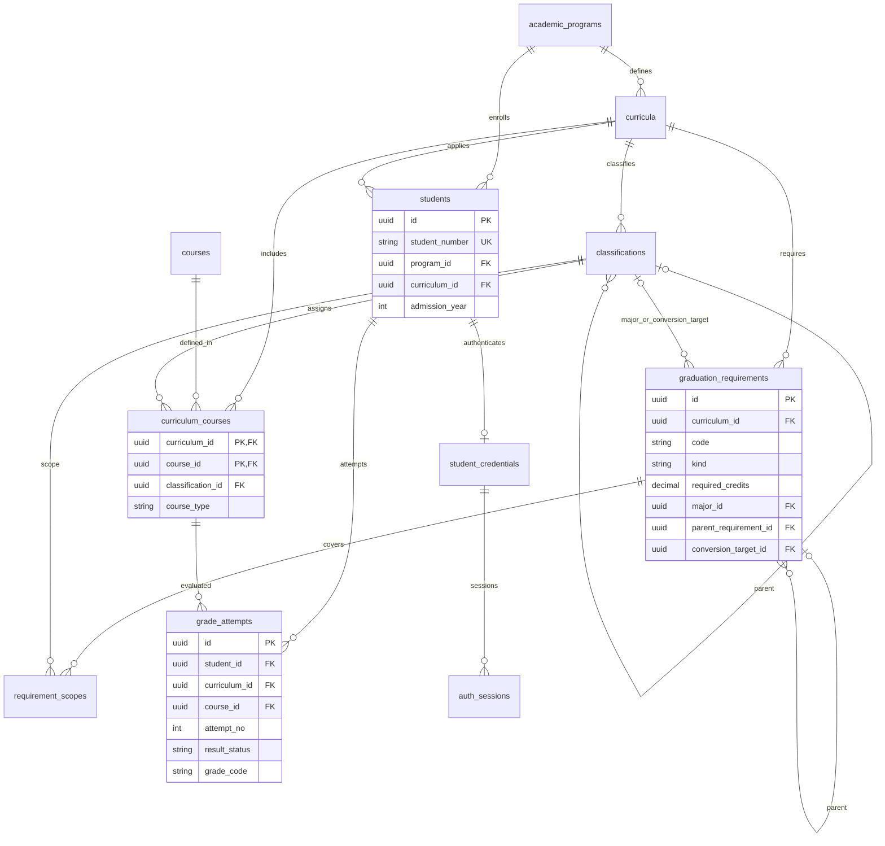

# DB基本設計

## 1. 方針と記法

[RDD](RDD.md)第9章を基準とするRDB論理設計。DB製品、DDL、マイグレーションは今回作成しない。全学生に共通の2026年度・先進情報専攻・人工知能コースのカリキュラムを明示的に割り当てる。入学年度はプロフィール情報であり、カリキュラム選択条件にしない。

PK=主キー、FK=外部キー、NN=NOT NULL、UQ=UNIQUE。型は論理型であり、UUIDやUTC日時の物理表現は製品選定時に確定する。以下の全IDはUUID、単位数はDECIMAL(4,1)、日時はTIMESTAMP（UTC）とする。指定なしの列もNN、nullableの列のみNULL可。削除は原則RESTRICT、運用上の履歴・学生・マスタは学生APIから変更できない。

## 2. テーブル一覧

| テーブル | 区分 | 役割 |
|---|---|---|
| academic_programs | マスタ | 学部・専攻・コースの組合せ |
| curricula | マスタ | 適用課程、版、根拠資料 |
| courses | マスタ | 学生と独立した科目定義 |
| classifications | マスタ | 大分類・科目群・小分類の階層 |
| curriculum_courses | マスタ | カリキュラム内の科目種別・分類 |
| graduation_requirements | マスタ | 固定6種の要件と必要値 |
| requirement_scopes | マスタ | 要件に含む分類の集合 |
| students | 基本データ | 学籍番号・氏名・入学年度・適用課程 |
| student_credentials | 認証データ | 学生1人につき1つのハッシュと利用状態 |
| grade_attempts | トランザクション | 学生・科目ごとの履修回次と成績 |
| auth_sessions | トランザクション | 失効可能なサーバー保存型セッション |

## 3. カラムと制約

### academic_programs

| 列 | 型 | 制約・意味 |
|---|---|---|
| id | UUID | PK |
| code | VARCHAR(64) | UQ、安定した課程コード |
| faculty_name | VARCHAR(100) | 学部名 |
| specialization_name | VARCHAR(100) | 専攻名 |
| course_name | VARCHAR(100) | コース名 |

名称3列の組合せにもUQ。MVPでは対象課程のみ投入し、所属を自由入力させない。

### curricula

| 列 | 型 | 制約・意味 |
|---|---|---|
| id | UUID | PK |
| program_id | UUID | FK academic_programs.id |
| code | VARCHAR(64) | UQ、例 cs_ai_2026 |
| name | VARCHAR(100) | 表示名 |
| revision | INTEGER | CHECK > 0、マスタ更新時に増加 |
| source_document | VARCHAR(255) | docs/2026hcgakuseibinran.pdf |
| source_pages | VARCHAR(100) | 冊子61、83、85〜88、93〜94 |

UQ(id, program_id)を複合FKの参照先として持つ。

### courses

| 列 | 型 | 制約・意味 |
|---|---|---|
| id | UUID | PK、再履修の重複排除キー |
| code | VARCHAR(64) | UQ、公式コード未提供なら内部コードと明記 |
| name | VARCHAR(200) | 科目名。名称だけで同一視しない |
| credits | DECIMAL(4,1) | CHECK > 0 |

同名でも別科目なら異なるID。MVPでは同一IDの単位数変更を認めず、履歴単位の意味が変わる変更は別科目定義・要件改訂として扱う。

### classifications

| 列 | 型 | 制約・意味 |
|---|---|---|
| id | UUID | PK |
| curriculum_id | UUID | FK curricula.id |
| code | VARCHAR(64) | 同一カリキュラム内でUQ |
| name | VARCHAR(100) | 分類名 |
| level | VARCHAR(16) | CHECK major / group / subcategory |
| parent_id | UUID | nullable、同一表の親 |
| display_order | INTEGER | CHECK >= 0 |

UQ(curriculum_id, id)、UQ(curriculum_id, code)。複合FK(curriculum_id, parent_id)→classifications(curriculum_id, id)で別カリキュラムの親を禁止する。majorは親なし、groupはmajorの子、subcategoryはgroupの子。循環・階層型はシード検証で確認する。総合・人文・社会・自然科学・ウェルビーイングは便覧の科目群として保持し、人文・社会の内訳条件は各科目群を直接参照する。存在しない小分類を無理に作らない。

### curriculum_courses

| 列 | 型 | 制約・意味 |
|---|---|---|
| curriculum_id | UUID | PKの一部、FK curricula.id |
| course_id | UUID | PKの一部、FK courses.id |
| classification_id | UUID | 最も下位の所属分類 |
| course_type | VARCHAR(16) | CHECK required / selective / elective |
| display_order | INTEGER | CHECK >= 0 |

PK(curriculum_id, course_id)。複合FK(curriculum_id, classification_id)→classifications(curriculum_id, id)。親をたどって大分類・科目群・任意小分類を導出する。種別は人工知能コースでの確定種別を投入し、共通欄だけで判定しない。単位数はcoursesを参照し重複保存しない。

### graduation_requirements

| 列 | 型 | 制約・意味 |
|---|---|---|
| id | UUID | PK |
| curriculum_id | UUID | FK curricula.id |
| code | VARCHAR(64) | 判定ロジックの20コード |
| name | VARCHAR(200) | 表示名 |
| kind | VARCHAR(24) | CHECK total / major_total / required_courses / selective_group / subminimum / elective_total |
| required_credits | DECIMAL(4,1) | CHECK > 0 |
| major_id | UUID | nullable、total以外の所属大分類 |
| parent_requirement_id | UUID | nullable、subminimumの親選択必修条件 |
| conversion_target_id | UUID | nullable、selective_groupの換算先大分類 |
| conversion_policy | VARCHAR(24) | nullable、same_major / subcondition_unresolved |
| display_order | INTEGER | CHECK >= 0 |

UQ(curriculum_id, id)、UQ(curriculum_id, code)。major_id/conversion_target_idは同一カリキュラムのclassificationsへの複合FK、parent_requirement_idは同一カリキュラムの本表への複合FK。totalはmajor/親/換算列がnull。selective_groupのみ換算列が必須で換算先=major_id。subminimumのみ親必須。他種別は親・換算列null。参照分類がmajorであること、親がselective_groupであること、循環がないことはシード検証で保証する。

liberal_selectiveのpolicyはsubcondition_unresolved。他7群はsame_major。Q02解決後にpolicyと仕様を同時更新する。条件式文字列、任意スクリプト、汎用ルールエンジンは保存しない。

### requirement_scopes

| 列 | 型 | 制約・意味 |
|---|---|---|
| curriculum_id | UUID | 複合FK用 |
| requirement_id | UUID | PKの一部 |
| classification_id | UUID | PKの一部 |

PK(requirement_id, classification_id)。複合FK(curriculum_id, requirement_id)→graduation_requirements(curriculum_id, id)、複合FK(curriculum_id, classification_id)→classifications(curriculum_id, id)。selective_group/subminimumのみ使用。liberal_selectiveに5科目群を登録、人文・社会にそれぞれ1科目群を登録する。他7群にも対応群を1つ登録する。範囲は子孫科目を含む。同一条件内の親子重複は禁止、異なる選択必修群の科目集合は重複禁止、subminimumは親集合の部分集合のみ許可する。required_coursesは大分類内のrequired種別を全て対象とするため科目別条件表を増やさない。

### students

| 列 | 型 | 制約・意味 |
|---|---|---|
| id | UUID | PK |
| student_number | VARCHAR(32) | UQ、ログイン識別子 |
| name | VARCHAR(100) | 氏名 |
| program_id | UUID | FK academic_programs.id |
| curriculum_id | UUID | 共通カリキュラム |
| admission_year | SMALLINT | CHECK 1900〜9999、判定分岐に使わない |

複合FK(curriculum_id, program_id)→curricula(id, program_id)で所属と適用課程を一致させる。UQ(id, curriculum_id)は成績の複合FK用。シード検証で全学生がMVP共通カリキュラムを参照することを確認する。

### student_credentials

| 列 | 型 | 制約・意味 |
|---|---|---|
| student_id | UUID | PK、FK students.id、学生と1対0..1 |
| password_hash | VARCHAR(255) | Argon2idのパラメータ・saltを含む符号化文字列 |
| is_active | BOOLEAN | DEFAULT true |
| password_updated_at | TIMESTAMP | UTC |

ログイン学籍番号はstudentsから取得する。別ユーザーIDや平文パスワードを重複保持しない。無効化・パスワード変更時は既存セッションを失効させる。

### grade_attempts

| 列 | 型 | 制約・意味 |
|---|---|---|
| id | UUID | PK |
| student_id | UUID | 学生 |
| curriculum_id | UUID | 適用カリキュラム |
| course_id | UUID | 科目 |
| attempt_no | SMALLINT | CHECK > 0、同一科目内の履修回次 |
| academic_year | SMALLINT | nullable、CHECK 1900〜9999 |
| term | VARCHAR(16) | nullable、first / second / full_year / other |
| result_status | VARCHAR(16) | CHECK pending / finalized |
| grade_code | VARCHAR(1) | nullable、CHECK S / A / B / C / D / X |
| updated_at | TIMESTAMP | UTC、訂正を記録 |

UQ(student_id, curriculum_id, course_id, attempt_no)。複合FK(student_id, curriculum_id)→students(id, curriculum_id)、複合FK(curriculum_id, course_id)→curriculum_courses(curriculum_id, course_id)。これにより他課程の成績を混入させない。pendingならgrade_code IS NULL、finalizedならgrade_code IS NOT NULLのCHECKを設ける。未履修は行なし。修得状態・算入単位・代表成績は派生値で保存しない。複数学生の同一科目と同一学生の再履修を許可する。Rは対象外として投入を拒否し、既存データに現れれば判定不能とする。

### auth_sessions

| 列 | 型 | 制約・意味 |
|---|---|---|
| id | UUID | PK、内部管理用 |
| student_id | UUID | FK student_credentials.student_id |
| token_hash | CHAR(64) | UQ、ランダムセッショントークンのSHA-256 |
| csrf_token_hash | CHAR(64) | ランダムCSRFトークンのSHA-256 |
| created_at | TIMESTAMP | UTC |
| last_seen_at | TIMESTAMP | UTC |
| expires_at | TIMESTAMP | 絶対有効期限 |
| revoked_at | TIMESTAMP | nullable、失効日時 |

CHECK created_at <= last_seen_at <= expires_at。CSRF原値は認証済みAPIがセッションに結びつけて再発行できる設計とし、GET /auth/sessionで再発行時はcsrf_token_hashを置き換える。トークン原値はDB・ログに保存しない。複数タブは最新CSRFを再取得して再試行する。期限・失効・利用状態をリクエストごとに確認する。

## 4. ER図

ER図の属性は主要列のみ。複合FK、nullable、完全な列定義は第3章を優先する。

## 5. インデックスと読取

| 対象 | インデックス | 目的 |
|---|---|---|
| students | UQ student_number | ログイン検索 |
| students | curriculum_id | 共通課程の整合検証 |
| curriculum_courses | (curriculum_id, classification_id, display_order) | 全科目・分類表示 |
| classifications | (curriculum_id, parent_id, display_order) | 分類階層・表示順 |
| graduation_requirements | UQ(curriculum_id, code) | 要件読取 |
| requirement_scopes | (curriculum_id, classification_id) | 対象範囲の逆引き |
| grade_attempts | UQ(student_id, curriculum_id, course_id, attempt_no) | 本人成績と代表履歴の決定 |
| auth_sessions | UQ token_hash、(student_id, revoked_at)、expires_at | 認証、全失効、期限切れ整理 |

PK/UQによる索引と重複する索引は追加しない。FK単独索引は製品・実行計画に応じて補う。S02はcurriculum_coursesを起点に本人の成績をLEFT JOINまたは別取得する。成績起点では未履修科目が欠落するため使用しない。S01/S03の数値はDB保存せず同一判定関数の結果から生成する。

## 6. 投入・整合性・権限

シードは課程→カリキュラム→分類→科目→課程別科目→要件/範囲→学生/認証→成績の順でトランザクション投入する。便覧85〜88ページの全科目を照合し、必修16/21/21、選択必修必要値14/18/15、大分類38/42/44、総124を検証する。8つのコア選択必修と知能の専門演習3科目を確認する。分類範囲・換算先・必須20条件の検証は[判定ロジック](graduation_requirement_logic.md)に従う。

学生APIのDB操作は本人の基本情報・成績・マスタの読取と認証セッションの更新だけ。成績・マスタへの書込経路は設けず、SQL/シード運用と分ける。DB製品が対応する場合はアプリ用権限でも成績・マスタの更新を制限する。セッション更新権限は必要だが成績更新権限とは別である。バックアップ・環境別接続情報はQ05で確定する。

関連：[API](api_specification.md)、[テスト](test_specification.md)、[未確定事項](open_questions.md)。
