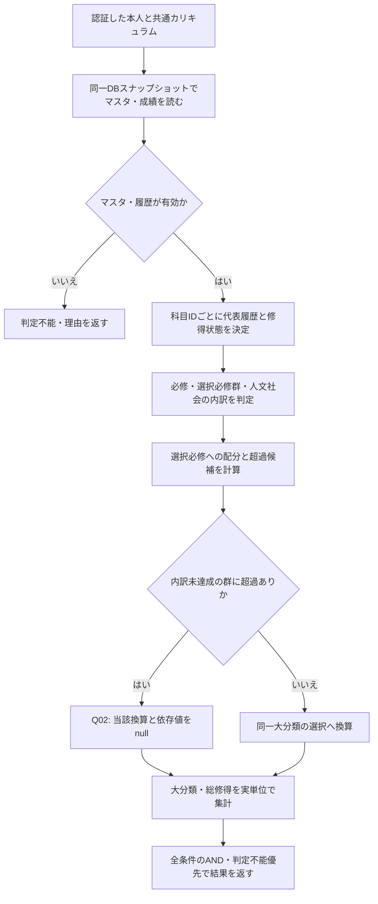

# 卒業要件判定ロジック設計

## 1. 対象と根拠

[RDD](RDD.md)第6〜7章を基準に、2026年度・先進情報専攻・人工知能コースの卒業単位要件のみを判定する。根拠は[学生便覧](2026hcgakuseibinran.pdf)冊子61、83、85〜88、93〜94ページ（PDFは冊子ページ+2）。入学年度による切替、進級、GPA、正式な卒業認定、単位認定Rは対象外。科目・要件はマスタから読み、一般的な式評価エンジンは作らない。

## 2. 要件コードと必要値

コードはDB・API・テストで共通に使用する。大分類コードは `practical`、`foundation`、`specialized` とする。

| コード | 条件 | 必要単位 | 大分類 |
|---|---|---:|---|
| total | 総修得 | 124 | 全体 |
| practical_total | 大分類合計 | 38 | practical |
| foundation_total | 大分類合計 | 42 | foundation |
| specialized_total | 大分類合計 | 44 | specialized |
| practical_required | 全必修科目の修得 | 16 | practical |
| foundation_required | 全必修科目の修得 | 21 | foundation |
| specialized_required | 全必修科目の修得 | 21 | specialized |
| liberal_selective | 総合・人文・社会・自然科学・ウェルビーイング | 10 | practical |
| foreign_selective | 外国語の選択必修 | 2 | practical |
| information_selective | 情報・数理の選択必修 | 2 | practical |
| math_selective | 数理の選択必修 | 4 | foundation |
| management_selective | マネジメントの選択必修 | 2 | foundation |
| computing_selective | コンピュータ・ビジネスの選択必修 | 12 | foundation |
| core_selective | 人工知能コースのコア選択必修 | 12 | specialized |
| seminar_selective | 知能の専門演習の選択必修 | 3 | specialized |
| humanities_min | liberal_selective内の人文 | 2 | practical |
| society_min | liberal_selective内の社会 | 2 | practical |
| practical_elective | 直接選択+同一大分類の超過換算 | 8 | practical |
| foundation_elective | 同上 | 3 | foundation |
| specialized_elective | 同上 | 8 | specialized |

必修58、選択必修47、選択19は上記の小計であり、追加の独立条件として重複登録しない。人文・社会は親10単位の一部。自然科学・ウェルビーイング等に独自の最低値を設定しない。

## 3. 処理フロー



## 4. 成績と代表履歴

成績は確定時のみS・A・B・C・D・X。S/A/B/Cを修得済み、D/Xを未修得とする。未確定は履歴あり・成績null、未履修は履歴なし。Xの意味は便覧で未受験による不合格と確認済み。修得フラグや「修得単位」列は独立保存せず導出する。

同一科目の履歴を `attempt_no` 順に扱う。修得済み履歴が1つでもあれば最新の修得済み履歴を代表にし、後続のD/X/未確定で修得を取り消さない。修得済みがなければ最新回次を代表にする。成績・年度・学期は同じ履歴から採用する。複数合格でも科目の単位数を1回のみ算入し、成績の最高評価を選ぶ処理は行わない。訂正は履歴の既存行をシード等で更新する前提。取消・特殊な認定は対象外とする。

科目の単位数は科目マスタ、種別・分類は課程別定義を使用する。科目名の一致で履歴をまとめない。Rや未知の記号、履歴矛盾を検出した場合は0単位に黙って読み替えず判定不能にする。

## 5. 判定と配分

必修は対象大分類の必修科目集合と修得済み集合の差を取り、未修得科目名・単位数を返す。単位数だけが一致しても、全必修科目の修得を代替できない。

選択必修は課程別種別が `selective` の科目のみ、群ごとに重複を除いて集計する。別群の超過を不足群へ移さない。人文・社会は親群に属する修得済み科目集合の部分集合から計算する。

```text
raw[g] = 群gに属する修得済み選択必修科目の実単位合計
allocated[g] = min(raw[g], required[g])
deficit[g] = max(required[g] - raw[g], 0)
excess_candidate[g] = max(raw[g] - required[g], 0)
converted[g] = excess_candidate[g]  # Q02の対象以外
elective[m] = 大分類mの直接修得選択単位 + sum(converted[g] for g in m)
major_earned[m] = 大分類mの修得済み科目の実単位合計
total_earned = 全修得済み科目の実単位合計
deficit[condition] = max(required[condition] - credited[condition], 0)
```

換算は実単位の配分であり新たな修得ではない。 `raw[g] = allocated[g] + converted[g]` を保つ。大分類の実単位は、必修実単位+選択必修raw+直接選択に等しく、配分済み選択必修+換算後選択を使っても同じ値になる。親子の内訳値、換算値を総修得に追加しない。

総合等で人文または社会が未達成、かつ `excess_candidate > 0` の場合はQ02未解決のため `converted=null`、実学基礎の `elective/deficit/status` はnull/null/indeterminateとする。総実単位、群10単位条件、人文・社会の判定は計算できる。超過0なら換算0であり、この未確定仕様に依存しない。全体は未達成条件が既知でも、判定不能条件があればindeterminateを優先する。これは安全な表示上の扱いであり、大学の換算禁止を確定したものではない。

## 6. 擬似コード

```text
evaluate(student, snapshot):
    curriculum, definitions, requirements, attempts = read_same_snapshot(student)
    issues = validate(curriculum, definitions, requirements, attempts)
    if issues:
        return indeterminate(issues, numeric_results=null)

    earned = set()
    rows = []
    for definition in definitions:
        history = attempts.for_course(definition.course_id)
        passed = history.where(finalized and grade in [S, A, B, C])
        representative = latest_attempt(passed if passed else history)
        state = earned if passed else pending_or_failed_or_not_taken(representative)
        rows.append(course_row(definition, representative, state))
        if passed: earned.add(definition.course_id)

    required_results = compare_all_required_courses(definitions, earned)
    group_results = sum_selective_by_disjoint_groups(definitions, earned)
    sub_results = sum_subsets(group_results, earned, humanities_min, society_min)
    allocations = allocate_minimum_and_excess(group_results)
    if liberal_excess_positive and any_liberal_subcondition_unmet:
        allocations.liberal.converted = null
        issues.add(UNRESOLVED_CONVERSION)
    elective_results = direct_electives_plus_same_major_conversions(earned, allocations)
    major_results = sum_actual_credits_by_major(earned)
    total = sum_actual_credits_once(earned)
    results = required_results + group_results + sub_results + elective_results + major_results + total
    overall = indeterminate if any_indeterminate(results) else (met if all_met(results) else unmet)
    return rows, results, allocations, overall, issues
```

## 7. 具体例

| 入力 | 計算 | 結果 |
|---|---|---|
| 外国語選択必修4、必要2 | 選択必修算入2、超過換算2 | 外国語由来の総修得は4のまま |
| 実学基礎必修16、総合等10、外国語4、情報2、直接選択6 | 実単位38、選択必修算入14、換算2、選択算入8 | 人文・社会各2以上なら実学基礎達成 |
| 同上、人文0・社会2、総合等12、直接選択4 | 実単位38、総合等超過候補2、外国語換算2 | 人文は未達成、総合等換算null、選択算入null、全体判定不能 |
| 総合等10、人文0・社会2 | 超過0、換算0 | 人文未達成。ほかが達成でも全体未達成 |
| 2単位科目にD→B→A | 最新合格Aを表示、科目ID1つ | 修得2単位。4単位としない |
| 総修得124、必修2単位科目が未修得 | 総不足0、必修不足2 | 全体未達成。余剰選択で代替しない |
| 総修得123/124 | 総不足1/0 | 123は未達成。124は他条件も全て達成したときのみ達成 |

## 8. マスタ・履歴検証とエラー

必須の20条件が存在し、必要値・課程・分類・換算先が上表と一致することを検証する。全必修の単位合計16/21/21、選択必修最低合計14/18/15を確認する。分類の循環、同一群の重なる範囲、複数選択必修群への同一科目所属、別大分類への換算、対象科目の欠落、負数、未知の種別・記号、成績と確定状態の矛盾、対象外Rを拒否する。親の内訳条件による重なりは許すが追加配分しない。

マスタ不整合は `MASTER_INCONSISTENT`、対象外・未知成績は `UNSUPPORTED_GRADE`、履歴不整合は `GRADE_INCONSISTENT` とし、数値をnullとして判定不能を返す。全selective科目が必ず1つの選択必修群に所属することも検証し、所属先のない科目を集計から黙って除外しない。正常な成績0件は全科目未履修・修得0・未達成。DB接続失敗は判定不能JSONではなくAPIの503取得失敗。整合したスナップショットを取得できない場合も成功結果を返さない。

関連：[DB](database_design.md)、[API](api_specification.md)、[テスト](test_specification.md)、[未確定事項](open_questions.md)。
