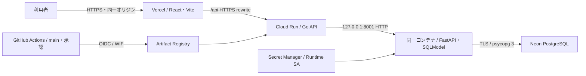

# 本番デプロイと運用

## 構成と責務



Goは公開HTTP・認可・Origin/CSRF・Cookie、Pythonは業務処理・DBを担当する。業務ルールと既存APIを維持する。単一コンテナのPID 1は`apps.runtime`とし、PythonのDB・スキーマ確認が完了してからGoをPORTで公開する。Pythonはループバックだけで待ち受ける。rootを使用しない。

子プロセスが停止したらコンテナ全体を失敗にする。SIGTERMではGoの処理を最大5秒で終了させ、その間はPythonを維持し、その後Pythonを停止する。Cloud Runの終了猶予内の8秒を目安に制御する。サイドカー方式もCloud Runで可能だが、今回の2プロセスには起動順・終了順を一か所で管理する方式を採用した。どちらも1リクエストがGo→Pythonと進む間にCPUを使用し、常時CPU割当を必要としない。

`/api/health`はGoのliveness。`/api/ready`はGo→Python→DBの接続を確認し、200または503を返す。DB障害でlivenessを失敗させず、再起動の連鎖を避ける。内部エラーや業務データは返さない。

## 初回公開準備の現在値

本番DB移行は承認後に完了している。新規DDL・SQLite移行・Seedを再実行しない。旧SQLiteへの書込み再開は禁止。2026-10-26に一括承認に基づく本番公開・HTTPS受入まで完了した。実測結果・Secret接続先の値非出力監査・実行承認・ロールバックは[初回公開準備](initial-release-readiness.md)を参照する。既存deploy.ymlは初回サービス作成とstage/promoteの個別承認に使用せず、初回公開成功後の通常CD有効化も別承認とする。

## 既存リソースと実行結果

対象はGCP `grad-checker-512505`、リージョン`asia-northeast1`、Artifact Registry `grad-checker`、Cloud Run `grad-checker-api`。Runtime SAは`grad-checker-runtime`、Deployer SAは`grad-checker-deployer`（いずれも同プロジェクト）。サービスアカウントキーは作成しない。

Vercelは既存の`grad-checker`、Root Directory `frontend`、Node.js 24、公開URL `https://grad-checker-chi.vercel.app`を再利用する。新しいプロジェクトは作成しない。Project/Org IDはGitHub Variablesを使用する。

2026-10-26に承認済みの本番移行とPR #75のmainマージが完了し、移行直後の本番DBは18テーブル・1,738行だった。公開受入後は承認済みの認証試行カウンターの通常削除等により18テーブル・1,735行となり、他の17テーブルは全カラム一致している。初期DDL・SQLiteコピー・卒業要件シードを再実行しない。DB名は既定の`neondb`と異なる`grad-checker`を使用する。main 8718b6cでGitHub DB SecretsとWIFの読取り監査が成功した。Cloud Run未作成は当時の監査結果であり、その後に固定digestで初回作成・公開した。現在のrevision・Vercel deployment・受入証跡は[実行監査](initial-production-execution.md)を参照する。

## 環境変数とSecret（値は記録しない）

| 名前 | 設定場所と用途 |
| --- | --- |
| `DATABASE_URL` | Web runtimeへSecret Managerから注入するpooled PostgreSQL接続。TLS必須 |
| `DIRECT_DATABASE_URL` | スキーマ・データ移行専用の直接接続。Webには注入禁止 |
| `PUBLIC_ORIGIN` | Web runtimeが認証で許可する唯一のHTTPS画面オリジン |
| `PORT` | Cloud Runが注入するGoの公開ポート |
| `CLOUD_RUN_API_ORIGIN` | Vercel設定評価時だけ使うHTTPS APIオリジン。VITE_*には不要 |
| `TEST_POSTGRES_URL` | 自動テスト専用のローカルPostgreSQL接続 |
| `GCP_PROJECT_ID`, `GCP_PROJECT_NUMBER`, `GCP_REGION` | GitHub Variablesの対象GCP情報 |
| `GCP_ARTIFACT_REPOSITORY`, `GCP_CLOUD_RUN_SERVICE` | GitHub Variablesの既存リソース名 |
| `GCP_SERVICE_ACCOUNT`, `GCP_WIF_PROVIDER` | GitHub VariablesのWIF設定 |
| `VERCEL_PROJECT_ID`, `VERCEL_ORG_ID` | GitHub Variablesの既存Vercel対象 |
| `VERCEL_TOKEN` | GitHub Secret。Vercel認証ステップにだけ渡す |
| `PRODUCTION_DEPLOY_ENABLED` | 承認後に有効化するGitHub Variable。未設定ではCDを実行しない |

既存の認証試行制限等は`backend/apps/settings.py`を参照する。`.env`等はGit管理外。Pythonは環境ファイルを自動ロードしない。DB接続URL・成績・パスワード・復旧コード・セッション原値をコード、ログ、コミット、PRへ記録しない。例外ログもDBのDETAILやSQLパラメーターを含めず、例外の種類だけを記録する。

通常APIにはSecret Managerの`grad-checker-database-url`バージョン1だけを渡す。`grad-checker-direct-database-url`はマイグレーション用の別実行主体に対して、そのSecret単位のAccessorを付与する設計とする。Runtime SAと通常CDのDeployer SAにはDirect Secretへの権限を追加しない。専用主体の選定・権限付与・新規リソース作成は承認時に行い、今回無断作成しない。既存GitHub SecretsのDB接続値はPRでは一切使用せず、保護されたmainの読み取り接続検証ワークフローでのみ確認する。

## Cookie・CORS・CSRF

ブラウザーは常にVercelの相対`/api`へアクセスする。`frontend/vercel.mjs`が`CLOUD_RUN_API_ORIGIN`から外部HTTPS rewriteを構成する。APIルートをSPAフォールバックより先に処理し、APIのエラーをHTMLへ変換しない。API応答はno-storeとする。

Cookieは既存のhost-only、Path=/、HttpOnly、Secure、SameSite=Laxを維持する。Vercel rewriteがSet-CookieをHTTPSの画面オリジンに返すため、第三者CookieやSameSite=Noneは不要。ReactからDB URLを参照しない。CORSは開放しない。Goは登録・ログイン等でもOriginを検証し、本人データの更新ではOriginとCSRFトークンの両方を検証する。別ユーザーのIDを外部入力として信頼しない。

Cloud Runへブラウザーから直接アクセスする別オリジン方式では、Cookie制限とCORS管理が必要となるため採用しない。Cloud Run自体は公開HTTP入口を持ち、業務APIでセッションを認証する。任意のForwarded/X-Forwarded-Forを信頼しない。プロキシ背後ではIP単位の認証試行枠を共有する可能性があるため、ユーザー名単位の制限とあわせて監視する。偽装可能なヘッダーを使ってこの制限を回避しない。

SPAの直接URL・再読込みはindex.htmlへfallbackする。CSP、X-Frame-Options、nosniff等を設定し、APIはindex.htmlにfallbackしない。

## ローカル開発と検証

通常の開発はリポジトリルートの`make setup`、`make dev`。SQLiteのローカル既定値は維持する。本番用コンテナではSQLiteへのフォールバックを拒否し、PostgreSQL・TLS・HTTPSのPUBLIC_ORIGINを必要とする。

```sh
make backend-check
make frontend-check frontend-test build
make backend-test
```

PostgreSQL検証はローカルDBを用意して`TEST_POSTGRES_URL`を設定する。全体テストのPostgreSQL項目をskipさせない。

```sh
docker build -t grad-checker-production:test .
uv run --locked --project backend python scripts/deployment/test_container.py
```

コンテナ検証は専用Dockerネットワーク・TLS PostgreSQL・合成データを使用する。Webを1CPU・512MiBに制限し、認証Cookie、CSRF、成績、卒業判定、履歴、別ユーザーのアクセス拒否、再起動後の永続化、依存障害、子プロセス障害、終了時間を検証する。検証用コンテナとネットワークだけを終了時に削除する。メモリ使用量・peak・終了時間を最後にJSONで出力する。ローカルHTTPでの検証ではSecure Cookieをテストコードが明示転送するため、実際のVercelでのブラウザー受入試験は別に必要。

管理されたクラウド開発環境でCA注入が必要な場合だけ、公開CAバンドルをBuildKitの`proxy_ca` secretとしてmountする。イメージへCAやプロキシ認証をCOPYしない。TLS検証を無効化しない。

自分の隔離DBで手動起動する場合は、Git管理外の`.env.runtime.local`にDATABASE_URLとPUBLIC_ORIGINを用意する。Direct URLは含めない。

```sh
docker run --rm -p 127.0.0.1:8080:8080 --memory=512m --cpus=1 \
  --env-file .env.runtime.local grad-checker-production:test
```

イメージはGoのビルドとPython依存解決を別stageで行い、runtimeには非rootユーザー、Go実行ファイル、非editableのPython環境だけを入れる。Git・テストDB・環境ファイル・開発用依存は含めない。

## GitHub Actions

| Workflow | 動作 |
| --- | --- |
| `check.yml` | PRと再利用可能CI。Python lint/型/全テスト、Go競合検出、PostgreSQL結合、Frontend lint/型/整形/テスト/build、Docker build/実行試験 |
| `deploy.yml` | main push/手動実行→CI→承認ゲート→WIF→既存リソース確認→SHAタグのbuild/push→Cloud Run更新→readiness→Vercel本番用build→ドメイン未割当でstage→proxy/SPA検証→promote→本番疎通 |
| `production-preflight.yml` | mainの完全SHA指定・production承認後、GitHub通常/direct Secretの本番接続先・TLS・18テーブル/1,738行を読取り検証。別jobのWIFは既存Registry/Cloud Run inventoryの読取りだけ。公開操作なし |
| `database-connectivity.yml` | mainの承認済み手動実行だけで、既存GitHub Secretsのpooled/direct接続を読み取りSELECT 1で確認。DDLなし |
| `graduation-benchmark.yml` | 既存の合成データ性能検証 |

Vercelの本番用ビルド後は、生成された`.vercel/output/config.json`を検査してAPI中継・SPAの除外条件・no-storeを確認してからstageする。`vercel pull`はumask 077で実行し、取得した環境ファイルをartifactへ含めない。

Cloud Run更新とVercel公開は別ジョブ・別runnerで実行する。WIFのid-token権限とGCP認証ファイルをフロントエンドの依存インストール・ビルドへ渡さない。両ジョブにproduction environmentを指定し、それぞれ承認ポリシーを検証する。

PRでは本番Secret・WIF・実クラウドの変更を使用しない。CIのPostgreSQLは合成データ専用である。Actionsは確認したcommit SHAに固定する。デプロイは直列化し、実行中の本番更新を新しいpushで強制キャンセルしない。失敗時は後続のVercel昇格等へ進まない。

本番CDを有効化する前に、GitHubの`production` environmentへrequired reviewerを1人以上設定し、deployment branch policyをcustomで`main`のbranchだけに制限する。CDはこのポリシーをAPIで検証し、不足・読み取り不可ならWIFより前に停止する。GitHubの契約でrequired reviewerを利用できない場合はCDを有効化せず、同等の承認設計を別途決める。

`PRODUCTION_DEPLOY_ENABLED`を未設定のままにしておけばmainへのマージ後も公開操作は実行しない。初回公開・承認設定・対象確認後にだけ有効化する。Vercel Git自動デプロイは設定ファイルで無効化し、Actions経由に統一する。既存のVercel側Git連携状態も初回公開前に確認する。

## 初回公開の順序と今後の通常CD

初回構築・公開IAM・Vercel stage・検証後の昇格はユーザーの一括承認に基づき実施済み。
GitHub productionのRequired reviewer承認は回避していない。
自動公開フラグは未設定であり、通常CDを有効にする操作は今回行っていない。
詳細と既知の制約は[実行監査](initial-production-execution.md)を優先する。

1. PRの最新HEAD・CI・差分とバックアップをレビューし、承認範囲内でマージする。
2. 完了済みのDB移行・Seedの証跡と現在のデータを読み取りで照合する。本番DDL・コピー・Seedを再実行しない。
3. Secret Managerの通常接続とDirect接続が対象DBを指し、TLS設定を保持していることを確認する。Runtime SAには通常接続Secretだけを渡す。
4. `Initial private production service`を固定main SHAで手動実行する。隔離TLS DBでのコンテナ試験成功後にWIF認証し、既存Registryへpushする。
5. 既存サービス不在を確認した場合だけ、取得したdigest固定manifestをCloud Run v2 create APIへ送る。既存サービスは更新・上書きしない。
6. 非公開revisionのReady・設定・認証済みreadiness・匿名拒否・DB不変性を先に確認する。
7. 管理者が当該サービスにだけallUsersの`roles/run.invoker`を設定し、Invoker IAM checkは維持する。Deployerへ広いrun.adminを追加しない。
8. 実Cloud Run originでVercelをビルドし、`--prod --skip-domain`でstageを作成する。Origin・CSRF・認証・成績・判定・履歴・SPAを検証する。
9. 全stage検証が成功した場合だけpromoteし、通常のHTTPSブラウザーで受入検証する。失敗を飛ばして次の公開工程へ進まない。
10. 専用テストデータだけを後片付けし、既存データ・ログ・実測・費用を確認して記録する。

WIFはmain限定を維持する。GitHub DB SecretsとWIFはmain 8718b6cの読取り監査40269546985でも検証済み。
通常CDの有効化は別途判断し、production承認と固定対象の確認を維持する。
今回のSPA検査修正を取り込む前にフラグを有効にしない。

## 本番受入

HTTPSのブラウザーで次を確認する。テスト用アカウント作成も本番への書込みなので承認した範囲で行う。

- 画面表示、直接URL/再読込み、言語切替が正常。
- 登録・ログイン・ログアウト・復旧が動作し、CookieがHttpOnly/Secure/SameSite=Laxである。認証・DB情報がJSやレスポンスへ混入しない。
- 所属選択、成績の登録/編集/削除、卒業判定、保存済み履歴とページングが正常。
- 不正Origin、CSRFなし、期限切れセッションを拒否し、別アカウントから他人の履歴が見えない。
- 再デプロイ後も成績・セッション・判定履歴が保持される。
- Cloud Runの5xx/latency/memory/OOM、Neonの接続数とcompute、VercelのAPI中継エラーを確認する。

## ロールバックと障害対応

Cloud RunのリビジョンとSHAタグ、Vercelの正常deployment URLを公開時に記録する。アプリのロールバックは既存の正常Cloud Runリビジョンへtrafficを戻し、Vercelも対応する正常なproduction deploymentへ戻す。運用中の本番切替は承認を受けて実行する。DBのschema/dataを自動的に巻き戻さない。旧アプリとの互換性を確認し、切替後のデータを保持する。

```sh
# 承認後。正常なrevision名をオペレーターが指定する。
gcloud run services update-traffic grad-checker-api --region asia-northeast1 \
  --project grad-checker-512505 --to-revisions "$KNOWN_GOOD_REVISION=100"
vercel rollback "$KNOWN_GOOD_PRODUCTION_DEPLOYMENT"
```

Vercel rollback後は自動ドメイン割当の状態を確認し、再開時は検証済みproduction deploymentをpromoteする。Cloud Run更新後にVercelが失敗した場合、バックエンドだけが更新された状態になるため、既存フロントとの互換性・readinessを確認してから再試行または承認済みrollbackを行う。

| 症状 | 確認・対応 |
| --- | --- |
| 起動失敗 | TLS付きDB設定、スキーマとトリガー、PUBLIC_ORIGIN、通常Secretのversion/Accessor。Direct SecretをWebへ渡していないか |
| `/api/health`は200、`/api/ready`は503 | Python/Neonの接続・compute再開・タイムアウト。DB障害を理由にliveness設定を変更しない |
| WIF失敗 | repository/main条件、provider、deployerのworkloadIdentityUser、対象project番号。SA keyを作って回避しない |
| Vercel 403 | 既存チーム/プロジェクトへの権限、VERCEL_TOKEN、deployment protection。保護を解除せずvercel curlで検証 |
| ログイン後に401 | proxyのSet-Cookie、HTTPS、PUBLIC_ORIGIN、host-only Cookie、Origin/CSRF。CookieをJS保存しない |
| 429増加 | 認証試行枠・ユーザー名・プロキシ単位枠の状況。Forwardedヘッダーを無条件で信頼しない |
| 512MiBでOOM | memory peakと同時認証数、concurrency=4を確認。先に並列度を下げ、再計測後に必要ならメモリ増加を承認する |

## 費用・保持方針

Cloud Runは1CPU、512MiB、最小0、最大1、request-based、concurrency 4、startup CPU boostなしを初期値とする。ローカルの合成データ計測は本番負荷の保証ではないため、公開後にmemory/latency/OOMを監視する。最大1も無料を保証しない。Cloud Runの無料枠は対象リージョンの扱いと月間リクエスト・vCPU秒・GiB秒・転送、Artifact Registryは保存量、Secret Managerはversion/アクセス、Neonはcompute/保存量、Vercel Hobbyは利用上限をそれぞれ確認する。

請求Budget/通知・アラートの作成は追加リソースのため今回自動作成しない。公開前に予算通知の宛先と上限を決め、公開直後と毎月Google Cloud Billing、Cloud Runメトリクス、Artifact Registry保存量、Neon/Vercel usageを確認する。無料枠の金額・量をコードに固定しない。

Artifact Registryは最新の正常デプロイ、直前の正常ロールバック用、現在trafficがある全revisionのイメージを保持する。古いSHAイメージは少なくとも14日のrollback期間を置いてから候補にし、保護タグや参照revisionを照合するdry-runの結果を承認してから削除する。SHAタグはtagged扱いなのでuntagged削除だけでは掃除できない。cleanup policyは実際の履歴と保持容量を確認するまで有効化しない。

アクセスログはUvicorn側で無効にし、Goにも本文・Cookieのログを追加しない。正常要求ごとの独自ログを増やさず、Cloud Runの標準メトリクスと異常の種類を中心に監視する。

参考：[Cloud Run runtime contract](https://docs.cloud.google.com/run/docs/container-contract)、[Cloud Run public access](https://docs.cloud.google.com/run/docs/authenticating/public)、[Vercel rewrites](https://vercel.com/docs/routing/rewrites)、[Neon connection pooling](https://neon.com/docs/connect/connection-pooling)。

## ローカル計測結果

2026-10-23の合成データ試験では、1CPU・512MiB制限で全フローが成功し、実使用量151.7MiB、memory peak 160,653,312 bytes（約153.2MiB）、正常停止0.98秒だった。逐次操作による基礎計測であり、最大同時数や本番ネットワークでの負荷保証ではない。512MiBの初期設定を維持し、公開後も計測する。

実環境の確認結果・残る権限・実SQLiteからNeonへのリハーサル結果は[PR #75 本番移行前の監査](pre-production-audit.md)を参照する。

## 公開後の運用と開発統合

日常開発とリリースPRは[開発・リリースフロー](development-flow.md)に従う。devでは本番公開しない。予算通知の設定済み記録、今回の実測と24〜48時間の未完了監視は[安定化監査](post-release-stabilization-2026-10-27.md)を参照する。
