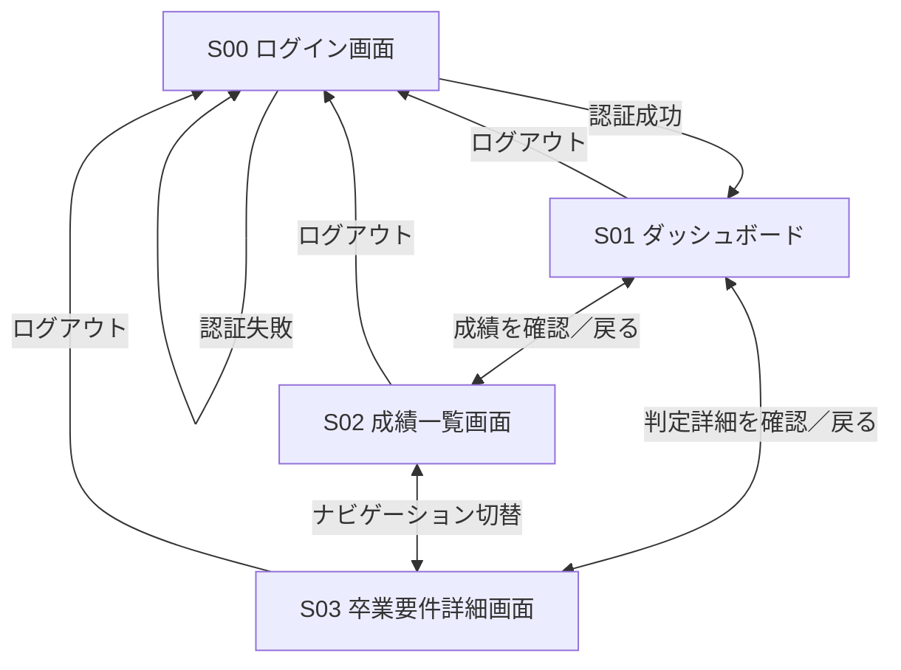

# Student Screen Design (MVP)

## 1. 概要

本ドキュメントは、卒業要件チェッカーWebアプリのMVPにおける**学生向け画面設計**を整理したものである。

- **対象**：東京工科大学 コンピュータサイエンス学部・先進情報専攻・人工知能コース
- **判定対象**：卒業単位要件のみ（進級・卒業課題着手・早期卒業等は対象外）
- **利用者**：学生
- **画面数**：4画面（S00〜S03）
- **基本方針**：学生は成績を閲覧できるが、登録・編集・削除はできない。
- **管理者画面**：MVPでは実装しない。成績・科目マスタ・判定ルールは開発者が事前に登録・管理する。

## 2. 画面一覧

| 画面ID | 画面名 | 目的 | 主な機能 |
| --- | --- | --- | --- |
| S00 | ログイン画面 | 利用者認証 | ログイン、認証エラー表示 |
| S01 | ダッシュボード | 卒業要件の達成状況を俯瞰 | 修得単位数、総不足単位数、区分別の達成概要、各画面への移動 |
| S02 | 成績一覧画面 | 履修成績を確認 | 合格・不合格を問わない成績一覧、科目名・単位数・成績・履修年度等の表示 |
| S03 | 卒業要件詳細画面 | 判定根拠と不足条件を確認 | 必修・選択必修・選択科目の充足状況、小区分・大区分の必要単位数と不足単位数、未修得必修科目の確認 |

## 3. 各画面の詳細

### S00：ログイン画面

**目的**：学生を認証し、自分のデータだけ閲覧可能にする。

**表示項目**
- ログインID
- パスワード
- ログインボタン
- 認証失敗時のエラーメッセージ

**処理・制約**
- 認証成功時はS01へ遷移する。
- 認証失敗時はS00に留まる。
- 未ログインでS01〜S03へアクセスした場合はS00へ誘導する。
- MVPでは学生の新規登録画面・パスワード再発行画面は設けない（アカウントは事前発行する前提）。

### S01：ダッシュボード

**目的**：卒業要件の達成状況をひと目で把握する。

**表示項目**
- 学生の基本情報（必要最小限）
- 修得済み総単位数と卒業に必要な総単位数
- 総不足単位数
- 必修・選択必修・選択科目などの区分別充足概要
- 卒業要件をすべて満たしているかの判定ステータス
- S02・S03へのリンク

**処理・制約**
- 成績データおよび卒業要件ルールから算出した結果を閲覧専用で表示する。
- 総不足単位数とカテゴリ別不足単位数は混同しない。
- 判定に必要な情報が不足している場合は「判定不可」などの状態を示す。

### S02：成績一覧画面

**目的**：成績情報そのものを確認する（卒業要件の判定画面ではない）。

**表示項目**
- 科目名
- 科目の単位数
- 成績（合格・不合格の双方）
- 履修年度・学期（データがある場合）
- 必要に応じて検索・絞り込み

**処理・制約**
- 不合格科目も一覧に表示する。
- 成績の登録・編集・削除機能は提供しない。
- 科目の単位数と実際に修得した単位数を区別する。不合格科目は修得単位に算入しない。
- 成績未確定の扱いはデータの状態に応じて表示する。

### S03：卒業要件詳細画面

**目的**：なぜ卒業要件を満たす／満たさないのかを確認する。

**表示項目**
- 総単位要件の充足状況
- 必修科目の修得状況、未修得必修科目
- 選択必修・選択科目の必要単位数／修得単位数／不足単位数
- 大区分・小区分ごとの必要単位数／修得単位数／不足単位数
- 選択必修の超過分を同一大区分の選択科目に換算した場合の内訳
- 未達成条件の一覧

**処理・制約**
- 判定結果は登録済みの成績と事前定義された卒業要件ルールから自動計算する。
- 選択必修の超過単位は、同一大区分への換算ルールに従って集計する。
- 特殊な他学部・他大学等の単位認定や一部の細則の厳密再現はMVPの対象外とする。

## 4. 画面遷移図

> S01〜S03は共通ナビゲーションで切り替え可能とする。認証されていない状態でこれらの画面へアクセスした場合、S00にリダイレクトする。

## 5. MVPのデータ・権限方針

| 項目 | MVPでの方針 |
| --- | --- |
| 学生アカウント | 開発者が事前登録 |
| 成績データ | 開発者がCSVまたはSQL等を使って事前登録・更新 |
| 科目マスタ | DBの初期データとして管理 |
| 卒業要件ルール | DBまたは設定ファイルで管理 |
| 学生の権限 | 自分の成績および卒業要件判定結果の閲覧のみ |
| 管理者機能 | 管理画面は作らないが、データ管理と判定処理は実装する |
| アクセス制御 | 認証した学生本人の情報に限定 |

## 6. MVP対象外・将来の拡張

- 管理者向け学生管理・成績管理画面
- 科目マスタ・卒業要件ルールの管理画面
- 進級・卒業課題着手・早期卒業の判定
- 入学年度によるカリキュラム分岐
- 特殊な単位認定への対応
- 学生による成績の自己申告・編集

**設計上の補足**：将来的に管理者画面を追加しやすいよう、成績の参照APIと更新処理を分離する。学生向けAPIには成績更新権限を付与しない。
