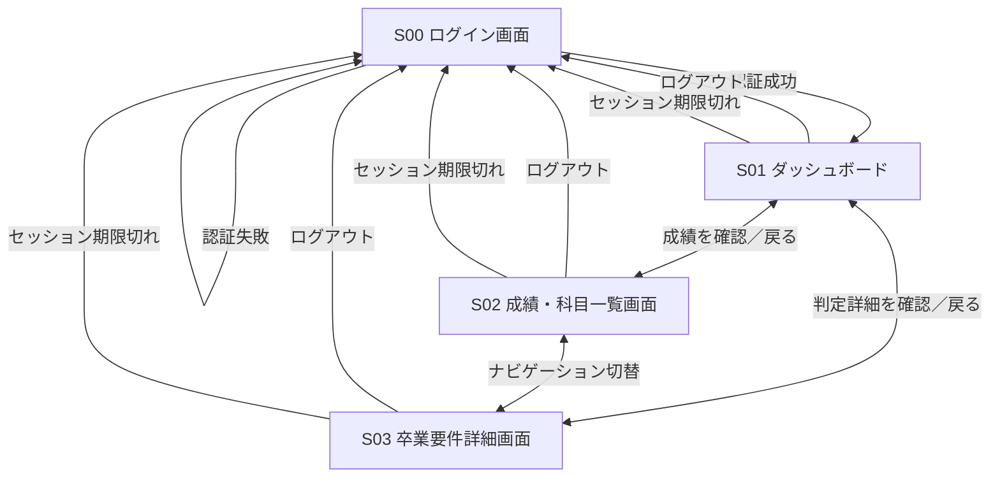

# Student Screen Design (MVP)

## 1. 概要

本ドキュメントは、卒業要件チェッカーWebアプリのMVPにおける**学生向け画面設計**を整理したものである。

- **対象**：東京工科大学 コンピュータサイエンス学部・先進情報専攻・人工知能コース
- **判定対象**：卒業単位要件のみ（進級・卒業課題着手・早期卒業等は対象外）
- **利用者**：学生
- **画面数**：4画面（S00〜S03）
- **基本方針**：学生は成績を閲覧できるが、登録・編集・削除はできない。
- **管理者画面**：MVPでは実装しない。成績・科目マスタ・判定ルールは開発者が事前に登録・管理する。

## 2. 画面一覧

| 画面ID | 画面名 | 目的 | 主な機能 |
| --- | --- | --- | --- |
| S00 | ログイン画面 | 利用者認証 | ログイン、認証エラー表示 |
| S01 | ダッシュボード | 卒業要件の達成状況を俯瞰 | 修得単位数、総不足単位数、区分別の達成概要、各画面への移動 |
| S02 | 成績・科目一覧画面 | 全科目と成績・修得状況を確認 | 未履修も含む全科目、分類・種別・単位数・成績・履修年度等の表示 |
| S03 | 卒業要件詳細画面 | 判定根拠と不足条件を確認 | 必修・選択必修・選択の充足状況、小分類・大分類の必要単位数と不足単位数、未修得必修科目の確認 |

## 3. 各画面の詳細

### S00：ログイン画面

**目的**：学生を認証し、自分のデータだけ閲覧可能にする。

**表示項目**
- 学籍番号
- パスワード
- ログインボタン
- 認証失敗時のエラーメッセージ

**処理・制約**
- 認証成功時はS01へ遷移する。
- 認証失敗時はS00に留まる。
- 未ログインでS01〜S03へアクセスした場合はS00へ誘導する。
- MVPでは学生の新規登録画面・パスワード再発行画面は設けない（アカウントは事前発行する前提）。

### S01：ダッシュボード

**目的**：卒業要件の達成状況をひと目で把握する。

**表示項目**
- 学生の基本情報（学籍番号、氏名、学部、専攻、コース、入学年度）
- 修得済み総単位数と卒業に必要な総単位数
- 「総単位数の不足○単位」（条件別不足との合算はしない）
- 必修・選択必修・選択科目などの区分別充足概要
- 卒業要件をすべて満たしているかの判定ステータス
- S02・S03へのリンク

**処理・制約**
- 成績データおよび卒業要件ルールから算出した結果を閲覧専用で表示する。
- 総不足単位数とカテゴリ別不足単位数は混同しない。
- 判定は「達成」「未達成」「判定不能」の3状態とする。
- 大分類別の合計必要値は38・42・44単位、総必要値は124単位。概要のみ表示し、科目群・内訳条件、未修得必修の一覧、換算内訳はS03に集約する。

### S02：成績・科目一覧画面

**目的**：成績情報そのものを確認する（卒業要件の判定画面ではない）。

**表示項目**
- 科目名、大分類、科目群・小分類
- 適用カリキュラムの種別（必修・選択必修・選択）
- 科目の単位数
- 成績（S・A・B・C・D・X・未確定・未履修）
- 修得状況（修得済み・未修得・成績未確定・未履修）
- 履修年度・学期（データがある場合）
- 検索・絞り込み・並べ替えは追加候補でありMVP必須ではない

**処理・制約**
- 不合格科目も一覧に表示する。
- 対象カリキュラムの全科目を大分類・科目群の表示順で一覧にする。成績がない科目も未履修として表示する。
- 成績の登録・編集・削除機能は提供しない。
- 科目の単位数と実際に修得した単位数を区別する。不合格科目は修得単位に算入しない。
- 成績未確定の扱いはデータの状態に応じて表示する。
- 算入規則はS・A・B・Cのみ算入、D・X・未確定・未履修は算入しない。便覧冊子61ページで、Dは不合格、Xは未受験による不合格と確認済み。Rは認定のためMVP対象外であり、検出時は判定不能とする。
- 修得済み行は淡い緑（暫定値 `#E8F5E9`、文字 `#1B1B1B`）と「修得済み」ラベルを併記する。その他は通常背景とし、Dは「未修得（不合格）」、Xは「未修得（未受験による不合格）」、記録あり未確定は「成績未確定」、記録なしは「未履修」とする。
- 同一科目は1行のみ。修得済み履歴があれば最新の修得済み履歴、それ以外は最新履修回次の成績を表示する。表示年・学期もその代表履歴に合わせる。履歴の時系列表示は将来対応。
- 未履修の履修年度・学期は「—」、小分類がない場合も「—」とし、0や架空値で埋めない。

### S03：卒業要件詳細画面

**目的**：なぜ卒業要件を満たす／満たさないのかを確認する。

**表示項目**
- 総単位要件の充足状況
- 必修科目の修得状況、未修得必修科目
- 選択必修・選択科目の必要単位数／修得単位数／不足単位数
- 大分類・科目群・小分類ごとの必要単位数／修得単位数／算入単位数／不足単位数
- 選択必修の超過分を同一大分類の選択科目に換算した場合の内訳
- 未達成条件の一覧

**処理・制約**
- 判定結果は登録済みの成績と事前定義された卒業要件ルールから自動計算する。
- 選択必修の超過単位は、同一大分類への換算ルールに従って集計する。別群の選択必修不足や必修不足へ充当しない。
- 必修58（16・21・21）、選択必修47（14・18・15）、選択算入19（8・3・8）単位以上を基準にする。総合等10単位に含まれる人文2・社会2単位を重ねて加算しない。
- 総修得124単位以上でも必修や選択必修の不足があれば全体は未達成。親子条件や大分類の不足を足して「残り○単位」と表示しない。
- 総合等の内訳不足かつ超過ありの場合は、Q02の確認まで当該換算と依存する選択条件、全体を判定不能とする。既知の内訳不足は未達成と表示する。
- 特殊な他学部・他大学等の単位認定や一部の細則の厳密再現はMVPの対象外とする。

## 4. 画面遷移図

> S01〜S03は共通ナビゲーションで切り替え可能とする。認証されていない状態でこれらの画面へアクセスした場合、S00にリダイレクトする。

## 5. MVPのデータ・権限方針

| 項目 | MVPでの方針 |
| --- | --- |
| 学生アカウント | 開発者が事前登録 |
| 成績データ | 開発者がSQLまたはシードデータで事前登録・更新。CSV取込機能は今回追加しない |
| 科目マスタ | DBの初期データとして管理 |
| 卒業要件ルール | RDBの卒業要件マスタで管理 |
| 学生の権限 | 自分の成績および卒業要件判定結果の閲覧のみ |
| 管理者機能 | 管理画面は作らないが、データ管理と判定処理は実装する |
| アクセス制御 | 認証した学生本人の情報に限定 |

## 6. MVP対象外・将来の拡張

- 管理者向け学生管理・成績管理画面
- 科目マスタ・卒業要件ルールの管理画面
- 進級・卒業課題着手・早期卒業の判定
- 入学年度によるカリキュラム分岐
- 特殊な単位認定への対応
- 学生による成績の自己申告・編集
- 同一科目の履修・再履修履歴の時系列詳細閲覧

**設計上の補足**：将来的に管理者画面を追加しやすいよう、成績の参照APIと更新処理を分離する。学生向けAPIには成績更新権限を付与しない。

## 7. 共通レイアウト・状態表示

PCを主対象に、S01〜S03の共通ヘッダーに学生氏名、ダッシュボード、成績・科目一覧、卒業要件詳細、ログアウトを配置する。現在画面を識別できる表示とキーボードフォーカスを設ける。狭い画面ではナビゲーションを折り返し、表は横スクロールとする。既存PNGは参考画像であり、文書更新後の本文が優先する。

| 状態 | 表示・動作 |
|---|---|
| 読み込み中 | 対象領域の読み込み表示。古い結果を新しい確定値として表示しない |
| 成績0件 | S02は全科目が未履修。S01・S03は有効なマスタがあれば修得0単位・未達成 |
| 認証失敗 | S00に共通メッセージ。学籍番号の存在は知らせない |
| セッション期限切れ | 本人データを消去しS00へ移動 |
| 通信・DB取得失敗 | 取得失敗と再試行操作。未達成や0単位と誤表示しない |
| 判定不能 | 理由と「判定不能」。nullの数値は「判定不能」と表示し、0にしない |
| 未確定の換算条件 | 当該換算値を確定表示せず、Q02の確認が必要であることを表示 |

各画面に「本システムが対応する単位要件に基づく判定です」を表示し、正式な卒業認定と区別する。

## 8. API対応と関連設計

| 画面 | API | 主なレスポンス項目 |
|---|---|---|
| S00 | POST /api/v1/auth/login | authenticated、student、csrf_token |
| 共通 | GET /api/v1/auth/session、GET /api/v1/me、POST /api/v1/auth/logout | 認証状態、学生基本情報、ログアウト |
| S01 | GET /api/v1/me/dashboard | total、majors、overall_status、warnings、issues |
| S02 | GET /api/v1/me/courses | coursesの分類・種別・成績・修得状況・代表履歴 |
| S03 | GET /api/v1/me/graduation-requirements | requirements、missing_required_courses、allocations、unmet_requirement_codes |

参照：[要件定義](../RDD.md)、[判定ロジック](../graduation_requirement_logic.md)、[DB](../database_design.md)、[API](../api_specification.md)、[テスト](../test_specification.md)、[未確定事項](../open_questions.md)。
